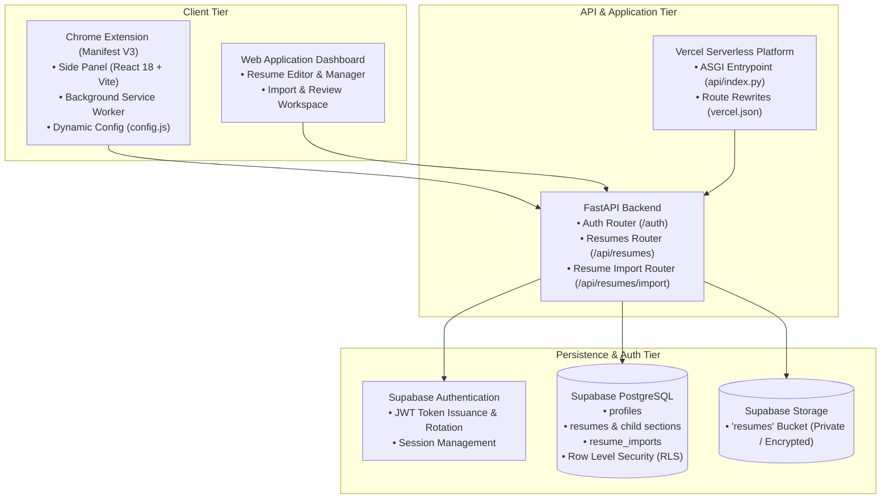

# TailorResume — AI Resume Tailoring Platform & Browser Extension

[](https://opensource.org/licenses/MIT)
[](https://www.python.org/)
[](https://react.dev/)
[](https://www.typescriptlang.org/)
[](https://developer.chrome.com/docs/extensions/mv3/intro/)
[](https://fastapi.tiangolo.com)
[](https://supabase.com)
[](https://vercel.com)

A modern resume-tailoring platform consisting of a web application and Chrome extension side panel that empowers users to maintain structured resumes, import existing resumes (PDF/DOCX), and manage job application drafts.

---

## Architecture Overview



---

## Key Modules & Capabilities

- **Module 1 — Authentication & Identity System**:
  - Secure authentication powered by Supabase Auth.
  - JWT validation with HMAC SHA-256 and refresh token rotation.
  - Profile persistence with row-level security (RLS).
  - Session preservation across extension and browser restarts.

- **Module 2 — Structured Resume Management**:
  - Full relational data model for resumes: personal info, summary, work experience, experience bullets, education, skills, projects, certifications, and portfolio links.
  - Cascade deletion and user ownership isolation.
  - Interactive Resume Dashboard and structured field editor.
  - Master resume selection and one-click duplication.

- **Module 3 — Resume Import & Deterministic Parsing**:
  - High-fidelity PDF and DOCX file extraction via `pdfplumber` and `python-docx`.
  - Deterministic regex section segmentation and experience parsing.
  - Interactive import review modal before saving to structured resume storage.
  - Private file persistence in Supabase Storage.

- **Module 4 — Job Detection & Job Description Extraction**:
  - Deterministic extraction from active browser tabs and job URLs.
  - Supported site adapters: LinkedIn, Naukri, Indeed, and ATS platforms (Greenhouse, Lever, Workday, Ashby, SmartRecruiters).
  - JSON-LD `JobPosting` schema traversal, semantic DOM fallback, and manual paste fallback.
  - Saved jobs library with deduplication and canonicalization.

- **Module 5 — Deterministic Job ↔ Resume Matching Engine**:
  - Authoritative backend matching algorithm (versioned, explainable).
  - 5-category scoring breakdown: Skills, Responsibilities, Experience, Qualifications, Keywords.
  - Evidence citations and freshness detection.

- **Module 6 — Resume Tailoring Engine**:
  - Grounded, fact-preserving tailoring engine (Conservative, Balanced, Strong modes).
  - Strict immutability: Master resumes are never modified or overwritten.
  - Generates tailored drafts and stores them as distinct, traceable versions with change logs.

- **Module 7 — Resume Templates & Preview**:
  - Real-time HTML/CSS resume template renderer.
  - 3 professional templates: ATS Classic, Professional, and Compact.
  - Zoom controls, print styling, responsive multi-page preview.

- **Module 8 — PDF / DOCX Generation**:
  - Server-side vector PDF generation via pure-Python `reportlab` (ATS-compliant, selectable text).
  - Native editable Microsoft Word `.docx` generation via `python-docx` with embedded OpenXML hyperlinks and bullet styles.
  - Direct in-memory streaming with RFC 5987 `Content-Disposition` and multi-tenant security isolation.

- **Module 9 — Chrome Extension Integration**:
  - Manifest V3 compliant side panel primary workflow (`activeTab`, `sidePanel`, `storage`, `scripting`).
  - Active tab job detection and instant tailoring directly on job listings.
  - End-to-end user workflow: Detect Job -> Review Details -> Select Master Resume -> Analyze Match -> Tailor Resume -> Preview -> Export PDF/DOCX.
  - Zero surveillance, zero background tracking, and secure Supabase token handling.

---

## Repository Structure

```text
├── api/
│   └── index.py                     # Vercel serverless ASGI entrypoint
├── backend/
│   ├── app.py                       # FastAPI core application
│   ├── config.py                    # Environment settings
│   ├── database.py                  # Database connection & pooling
│   ├── models/
│   │   └── database.py              # Relational models (profiles, resumes, imports)
│   ├── routes/
│   │   ├── auth.py                  # Authentication endpoints
│   │   ├── resumes.py               # Structured resume CRUD endpoints
│   │   └── resume_imports.py        # PDF/DOCX upload & parsing endpoints
│   └── services/
│       ├── auth_service.py          # JWT verification & profile management
│       ├── resume_service.py        # Structured resume business logic
│       ├── resume_parser.py         # Deterministic PDF/DOCX extraction & parsing
│       └── storage_service.py       # Supabase Storage client
├── extension/
│   ├── manifest.json                # Chrome Manifest V3
│   ├── config.js                    # Extension API configuration
│   ├── sidepanel.html               # Side panel entrypoint
│   ├── background/
│   │   └── service-worker.js        # Background service worker shell
│   ├── content/
│   │   └── content.js               # Content script foundation
│   └── ui/                          # React + TypeScript side panel UI
│       ├── src/
│       │   ├── App.tsx              # Main UI component
│       │   ├── components/resume/   # Resume dashboard & editor
│       │   ├── components/auth/     # Auth modal & user profile
│       │   └── services/            # API & Auth clients
│       └── package.json
├── supabase/
│   └── migrations/                  # Schema migrations & RLS policies
└── tests/                           # End-to-end and regression test suites
```

---

## Local Development Setup

### 1. Backend Setup

```bash
# Navigate to backend directory
cd backend

# Install dependencies
pip install -r requirements.txt

# Start FastAPI server
uvicorn backend.app:app --reload --port 8000
```

### 2. Extension UI Setup

```bash
# Navigate to extension UI directory
cd extension/ui

# Install dependencies
npm install

# Start Vite dev server or build for extension
npm run build
```

### 3. Load Extension in Chrome

1. Open `chrome://extensions/` in Google Chrome.
2. Enable **Developer mode** (toggle in upper right).
3. Click **Load unpacked** and select the `extension/` directory.

---

## Environment Variables

Copy `.env.example` to `.env` and provide your Supabase credentials:

```bash
cp .env.example .env
```

Key configuration variables:
- `SUPABASE_URL`: Supabase project URL
- `SUPABASE_ANON_KEY`: Supabase anon/public key
- `SUPABASE_SERVICE_ROLE_KEY`: Supabase service role key (backend only)
- `DATABASE_URL`: PostgreSQL connection string (Supabase Transaction Pooler)
- `SUPABASE_RESUME_BUCKET`: Private storage bucket name (`resumes`)

---

## License

MIT License.
